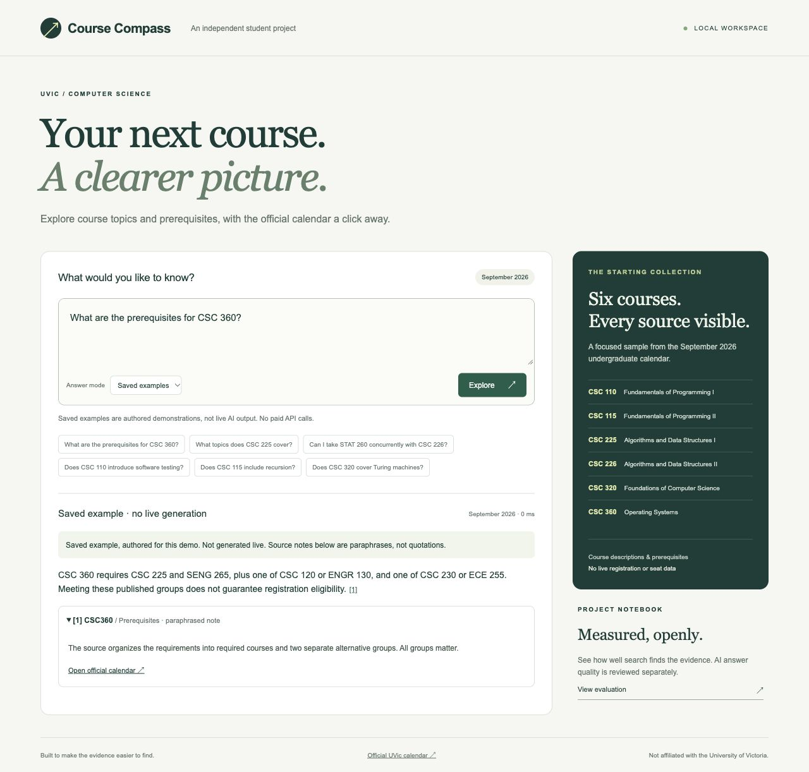
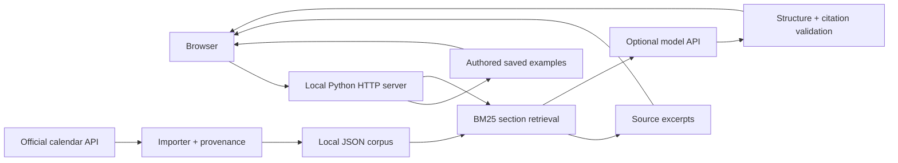

# Course Compass

Explore university course information with traceable sources. Built with Python and plain JavaScript, with a responsive interface, BM25 retrieval, citation validation, and a reproducible evaluation workflow.

**Try it without an API key:** the app opens in Saved examples mode. Six authored example answers demonstrate the interface using paraphrased source notes and links to UVic’s official calendar. These are clearly labeled demonstrations, not recorded model outputs or live AI answers. No paid requests or university downloads are needed for this mode.



## Quick start

Requires Python 3.11 or newer. From the repository root:

```bash
PYTHONPATH=src python3 -m course_compass serve --port 8776
```

Open **http://127.0.0.1:8776/**, choose an example question, and click **Explore**. On Windows PowerShell, set `$env:PYTHONPATH="src"` and run `python -m course_compass serve --port 8776`.

The project has no third-party runtime dependencies. It runs locally; this repository does not operate a hosted AI service. Viewing or cloning it cannot charge the author for API usage.

## Three modes

| Mode | What happens | Requirements |
| --- | --- | --- |
| Saved examples (default) | Displays an authored answer for one of six exact example questions | Python only; no network or API usage |
| Source excerpts | Searches imported official course sections and displays original evidence | Import the public course data locally |
| AI answer | Generates a structured answer and validates evidence IDs and exact quotes | Imported data and your own model credentials; paid API requests |

An unmatched question in Saved examples mode does not silently call the model. Source notes in saved examples are paraphrases, not quotations from the downloaded corpus.

## Live document search

The initial corpus covers **CSC 110, 115, 225, 226, 320, and 360**, using UVic’s September 2026 undergraduate calendar. Downloaded source snapshots and extracted text are excluded from this repository.

```bash
PYTHONPATH=src python3 -m course_compass ingest
PYTHONPATH=src python3 -m course_compass search "What are the prerequisites for CSC 360?"
PYTHONPATH=src python3 -m course_compass ask "What must I complete before CSC 226?"
```

Restart the local server after importing. Choose **Source excerpts** in the interface for arbitrary questions. The importer pins the catalog edition, preserves original requirement structure, records URLs/timestamps/hashes, and rejects invalid records. The source API is external and can change. See [source notes](docs/sources.md).

For optional AI answers, set `OPENAI_API_KEY` and `OPENAI_MODEL` in your process environment and choose **AI answer**, or pass `--mode model` to `ask`. The application does not load `.env` files automatically. Never commit credentials. Any model requests use the credentials of the person running the app. See [model setup and limitations](docs/search-and-answers.md).

## Architecture



Course identifiers and relevant fields receive explicit ranking boosts. Prerequisite sections remain whole to preserve nested requirements. Model output must cite retrieved section IDs with exact source quotations; URLs are supplied by the application. This validates quote existence, not semantic entailment.

## Measured results

A 50-question test set was frozen before its first evaluation: 32 answerable questions, 12 unsupported questions, and 6 ambiguous questions. At k=8 over 23 source sections:

| Measure | BM25 + course/field boosts | TF-IDF cosine |
| --- | ---: | ---: |
| All labeled evidence retrieved | 32/32 | 31/32 |
| Supporting-section recall | 100% | 94.1% |
| Mean reciprocal rank | 0.922 | 0.784 |

These are **retrieval results, not AI answer accuracy**. TF-IDF is a sparse lexical vector baseline, not semantic embeddings. The sample is small and related to development examples. Local rules abstained on 5/12 unsupported questions and requested clarification for all 6 ambiguous questions. No live model answers have been evaluated.

See the [evaluation protocol and full findings](docs/evaluation.md) and [machine-readable summary](evaluation/holdout-summary.json).

```bash
PYTHONPATH=src python3 -m unittest discover -s tests -v
PYTHONPATH=src python3 -m course_compass evaluate
PYTHONPATH=src python3 -m course_compass benchmark
```

The two evaluation commands require imported data. The frozen benchmark additionally requires the original corpus hash; a fresh upstream snapshot may differ. The archived summary records the original results. Tests run entirely offline with synthetic fixtures; GitHub Actions runs them on Python 3.11 and 3.14.

## Limits and next improvements

- Six courses and one edition; no live seat, schedule, or personal eligibility information.
- Authored examples demonstrate behavior and are not model-evaluation evidence.
- Citation validation does not prove that a model’s claim follows from the passage.
- Improve unsupported-question handling using development data, then create a new test set.
- Expand course coverage, compare semantic retrieval, and evaluate a local model or an API model within a fixed budget.
- The loopback development server is for local exploration, not public production hosting.

## Project guide

- [Interface and browser QA](docs/interface.md)
- [Search and answer pipeline](docs/search-and-answers.md)
- [Requirements](docs/requirements.md)
- [Evaluation and review rubric](docs/evaluation.md)
- [Source provenance and reuse notes](docs/sources.md)

Independent student project; not affiliated with the University of Victoria. University source content remains subject to its own terms. The repository contains code, authored examples, evaluation metadata, and demo screenshots, not the downloaded calendar corpus.
